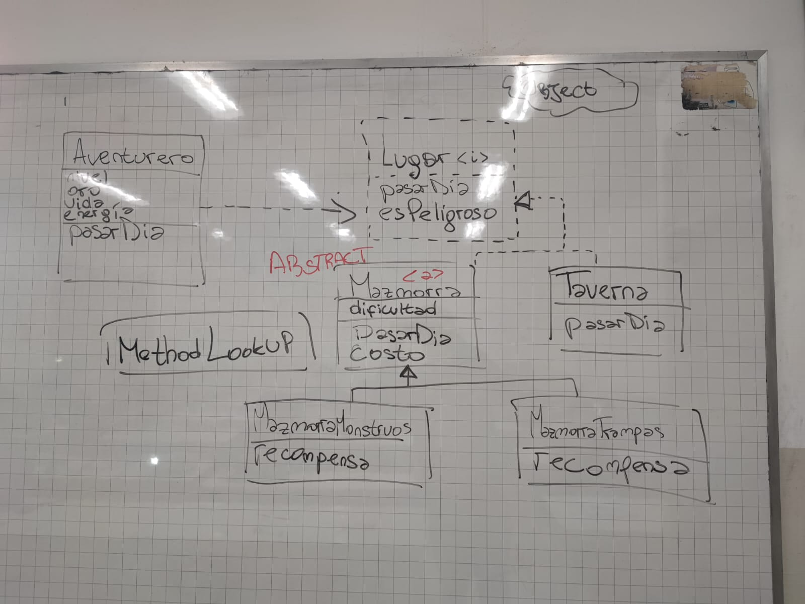
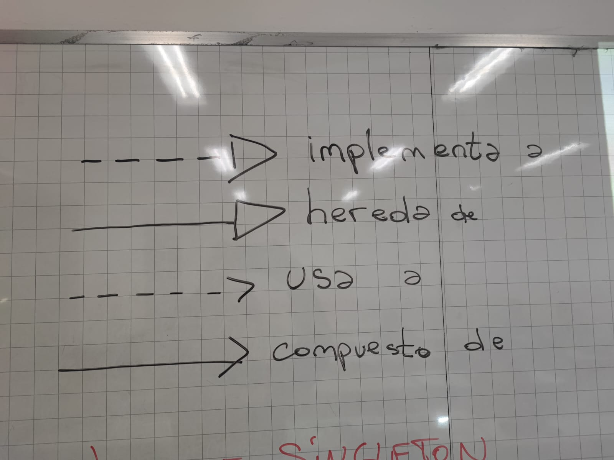

# Clase 19 - Herencia vs Composicion

Fecha: 19/10

### Materiales que dan soporte a los temas de hoy

* Codigo [Hecho en clase Gameflix](./assets/19-HerenciaVsComposicion/gameflix.wlk)
* PDF [Gameflix](./assets/19-HerenciaVsComposicion/Gameflix.pdf)

* Apuntes
  - [Diseño](https://docs.google.com/document/d/1lRTDAcsOwy7hkAM-UvTZtMHzN5fitrWyk1JAM-6NVJI/edit?usp=sharing)
  - [Herencia](https://docs.google.com/document/d/1KdG7NrKPgPh4bAcyLuDG2G1iWP7Ze2GFs91qzlvDKqI/edit?tab=t.0)

* TP Parte 3
  - [Enunciado](./assets/19-HerenciaVsComposicion/TP%20de%20Objetos%20-%20La%20Tierra%20Media%20-%20Entrega%203.pdf)

